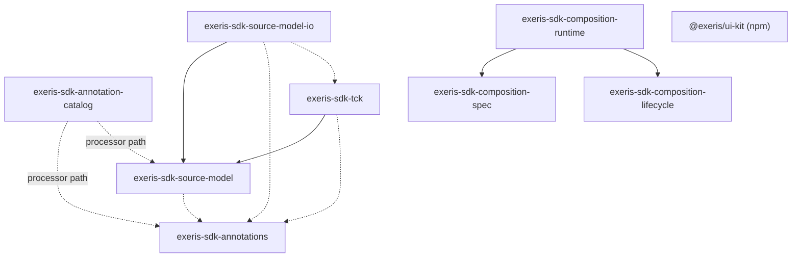

# Architecture

`exeris-sdk` is the most upstream repository of the Exeris ecosystem. It defines the vocabulary an application author writes (annotations), the shape every tool agrees on (the source model), and the composition modules that cross from build time into a booted artifact. This page explains how those parts fit together and why the boundaries sit where they do. It does not describe each annotation; the module READMEs and Javadoc own that.

## Entity-First: the class is the definition

[ADR-003](adr/ADR-003-entity-first-development-strategy.md) makes the `@ExerisDomain` class the only definition of a domain. SQL migrations, REST and GraphQL endpoints and DTOs are generated artifacts, produced during the build. The generators live downstream in `exeris-tooling`. Nobody writes `.proto` or OpenAPI files by hand.

The SDK contributes the first two links of that chain and none of the generation:

1. `exeris-sdk-annotations` declares the markers (`@ExerisDomain`, `@Field`, `@Action`, `@Relationship` and the rest).
2. `exeris-sdk-source-model` declares the records that describe a domain after extraction, rooted at `DomainMetadata`.
3. `exeris-tooling` reads the annotations with its processor, writes the records as JSON, and emits code from them.

## Why the SDK is upstream, and what it never does

Downstream repositories such as `exeris-tooling` and `exeris-platform` depend on the SDK; the SDK depends on none of them. [`zero-runtime-coupling.md`](https://github.com/exeris-systems/exeris-sdk/blob/main/.agents/policies/zero-runtime-coupling.md) owns the rules. The practical effect is that no annotation reaches bytecode (`AnnotationContractTest` enforces it), a tool that only reads the model never loads a Java parser or `jackson-databind` ([ADR-037](adr/ADR-037-source-model-io-module.md)), and the mapper that reads the wire format is always the consumer's own.

The SDK also never validates a capability graph, generates domain code, or touches the kernel. Resolving `@Requires` against `@Provides` is a build-time concern of `exeris-tooling`; the SDK ships only the manifest schema and the boot-time check.

## Module graph

The graph below is derived from the `<dependencies>` block and the compiler plugin's processor paths in each reactor module's `pom.xml`. Solid arrows are compile scope, dotted arrows are test scope, and the annotation-catalog edges are annotation-processor paths rather than dependencies.

Reading the graph:

- `exeris-sdk-annotation-catalog` is a build-time processor module. It is not published and has no SDK module dependencies. `exeris-sdk-annotations` runs it to emit `annotation-catalog.json` into its jar, and `exeris-sdk-source-model` runs it to emit `ast-schema.json` and `brief-schema.json` into its own.
- `exeris-sdk-source-model` depends on the annotations module at test scope only, so that a test can check the annotation enums against the AST enums by name. A consumer of the model does not receive the annotations transitively.
- `exeris-sdk-composition-spec` and `exeris-sdk-composition-lifecycle` depend on nothing in the SDK. Only `exeris-sdk-composition-runtime` joins them.
- `exeris-sdk-bom` and `exeris-sdk-parent` carry versions and build configuration; they carry no code, so they are not shown.
- `@exeris/ui-kit` is an npm package with its own version line and no edge into the Maven reactor ([ADR-094](adr/ADR-094-ui-kit-public-npm-own-version-line-tailwind-v4-only.md)).

## Build time, design time and boot time

The same source model serves three phases. Each phase uses a different slice of the SDK.

| Phase | Who runs it | SDK modules involved | What crosses |
|---|---|---|---|
| Build time | `exeris-tooling` processor and codegen | annotations, source-model, composition-spec | `exeris-metadata/<entity>.json`, `cap-manifest.json` |
| Design time | Studio, LSP, IDE plugins | source-model, source-model-io | `MutationOp` in, `ApplyResult` (a `MutationResult` plus the edited source) out |
| Boot time | A generated SKU bootstrap | composition-spec, composition-lifecycle, composition-runtime | `cap-manifest.json` read and asserted |

**Build time.** The processor extracts annotations into `DomainMetadata` and writes one JSON file per entity. That file is the baseline for everything else.

**Design time.** `exeris-sdk-source-model-io` parses a `.java` file into the same records (`SourceModelReader`) and writes edits back (`SourceModelWriter`). `SourceModelMutationApplier` applies one `MutationOp` from the sealed family at a time, and `SourceModelConflictDetector` compares the current source against the baseline to detect drift before an op is applied ([ADR-042](adr/ADR-042-bidirectional-mutation-surface.md)). The reader must agree with the processor; `exeris-sdk-tck` turns that parity into an executable gate.

**Boot time.** `CompositionStampAssertion` checks the validation stamp inside `cap-manifest.json` before any capability initializes, and `CompositionConductor` then drives each capability through `initialize` and `ready` in the manifest's `initOrder`, and through `drain` and `terminate` in the reverse order ([ADR-024](adr/ADR-024.link.md)). It does not re-resolve the dependency graph.

## The wire format is the hand-off

The producer and its consumers share no code at run time. They share a file. `exeris-metadata/<entity>.json` holds the serialized `DomainMetadata` plus two sibling trust fields, modeled by `BaselineTrust`:

- `sourceDigest` is `SourceDigest.of(source)`, a SHA-256 over line-ending and trailing-whitespace normalized text. It is the optimistic-concurrency token for a mutation.
- `schemaVersion` is `SchemaVersion.CURRENT`. A baseline stamped with any other value reads as `SCHEMA_VERSION_SKEW` instead of being assumed compatible.

`SchemaVersion` is a constant of its own, deliberately decoupled from the Maven artifact version. It changes only when an AST shape changes. The package-level rules for consumers, including the Jackson 3 `FAIL_ON_NULL_FOR_PRIMITIVES` posture, live in the `package-info.java` of `eu.exeris.sdk.sourcemodel.ast`. The enforced invariants live in [`ast-wire-format.md`](https://github.com/exeris-systems/exeris-sdk/blob/main/.agents/policies/ast-wire-format.md).

`cap-manifest.json` is the second hand-off. `CapManifest` and `CompositionBinding` in `exeris-sdk-composition-spec` define its read schema and its content-binding hash, so the emitter and the asserter cannot drift into two private copies.

## Where ui-kit sits

`exeris-sdk-ui-kit` is the Tailwind v4 theme and component classes for generated Angular applications. It is CSS plus a typed `defaultTheme` constant. It reads no AST and imports no Java. Generated UI uses it, but the SDK does not generate that UI; the codegen in `exeris-tooling` does. It is outside the Maven reactor, and the SDK's 1.0.0 freeze does not cover it ([ADR-094](adr/ADR-094-ui-kit-public-npm-own-version-line-tailwind-v4-only.md)).

## Rejected alternative: the model lives in tooling

The model could live in `exeris-tooling`, next to the processor that produces it. That would remove one repository boundary. The cost is that the LSP, Studio and every other reader would depend on the build pipeline to learn the shape of a domain. The README states the chosen rule: the model lives here, and tooling and platform depend on it, never the reverse.

## Trade-offs

- **One definition, many readers.** Putting the model upstream gives every tool one shape, but every AST change is a cross-repository contract change, which the record-growth stance in [`MIGRATION-0.x-to-1.0.md`](../MIGRATION-0.x-to-1.0.md) keeps non-breaking.
- **A textual digest.** `SourceDigest` ignores line endings and trailing whitespace but not other formatting, so a reformat can invalidate a baseline. That keeps `source-model` free of JavaParser.
- **Parity is a standing cost.** The reader in `-io` must mirror the processor's extraction. The TCK gates the facets it enumerates in `Facet`; `SourceModelReader.unmodeledFacets` reports the annotations whose data the reader cannot vouch for, so a round-trip caller can refuse.

## Where this does not apply

This page describes the SDK's own structure. It does not cover how `exeris-tooling` generates code, how the kernel boots, or how Studio presents mutations. For those, use the owning repository's documentation. It also does not list annotation status; the stability matrix and each annotation's Javadoc `Status:` line own that.
